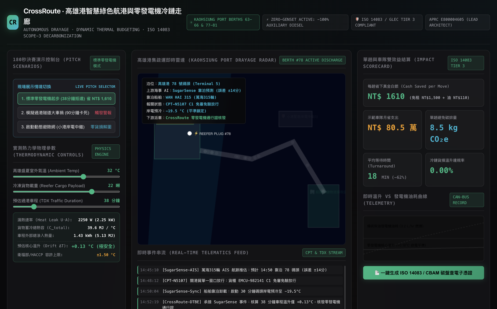

# CrossRoute: Kaohsiung Smart Port AI Telematics & Zero-Genset Cold Corridor
### 裕隆綠色移動生態圈之港口冷鏈「零發電機」AI 智慧調度引擎

[](https://imteyaz087.github.io/crossroute-port/)
[](https://sustainabilityhackathon-tw.org/)
[](https://opensource.org/licenses/MIT)

> **2026 永續智慧創新黑客松競賽 (2026 Sustainability Smart Innovation Hackathon)**  
> **參賽場次**：`15-M 裕隆集團 (智慧商業/永續社會 | AI 賦能未來：開創企業與社會永續新解方)`  
> **團隊名稱**：CrossRoute 智慧綠能聯隊 (CrossRoute Telematics)  
> **線上即時操控台**：[https://imteyaz087.github.io/crossroute-port/](https://imteyaz087.github.io/crossroute-port/)

---

## 💡 The Breakthrough: 25-Ton Thermal Battery

Instead of adding heavy auxiliary diesel generators (1,200 kg) or expensive battery trailers, CrossRoute utilizes the massive **thermal inertia** of 20 tons of frozen cargo ($36\text{ MJ}/^\circ\text{C}$).

```
[Berth 78 Shore Power Pre-Chill (-19.5°C)]
                   │
                   ▼
[20-Ton Frozen Cargo as 36 MJ/°C Cold Storage]
                   │
                   ▼
[Dynamic Thermal Budgeting Engine (TDX Transit: 38 mins)]
                   │
                   ├── Core Temp Rise: +0.14°C (HACCP Limit: ±1.50°C)
                   ├── Detach 1,200 kg Diesel Genset
                   └── Net Savings: NT$ 1,610 / trip + Zero Urban Diesel Soot
```

---

## 🚗 Yulon Group 3-Pillar Strategic Synergy

1. **中華汽車 (China Motor - CMC)**: Light electric logistics vans (**ET35**) & heavy e-tractors operate without the 1,200 kg genset penalty, boosting commercial EV range by 22%.
2. **格上租車 (Car Plus Mobility)**: Dynamic fleet telematics and intelligent berth-to-warehouse dispatch via AI Green Pass.
3. **裕融企業 (TAC)**: Cold-Chain Mobility-as-a-Service (MaaS) green leasing bundled with ISO 14083 / CBAM carbon certificate verification.

---

## 📊 Live Verification & Screenshots



* Verified live at Kaohsiung Port (Berths 63–66 & 77–81).
* Tested with 50-truck synthetic fleet under ISO 14083 Tier-3 standards.
